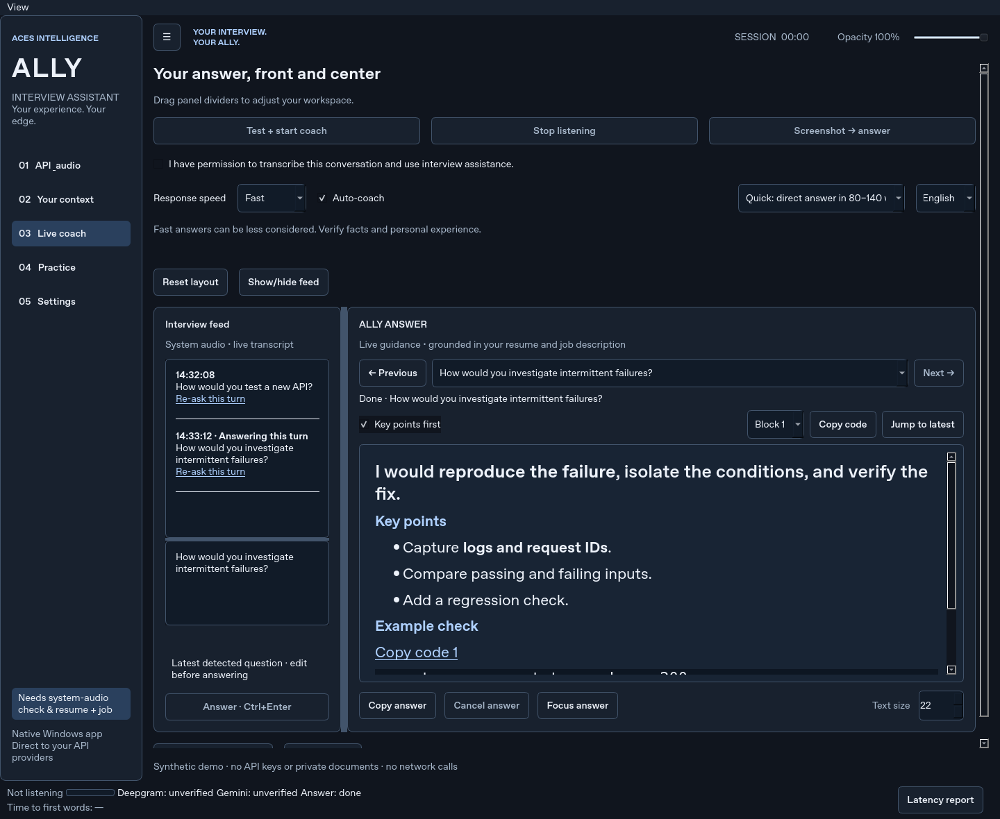
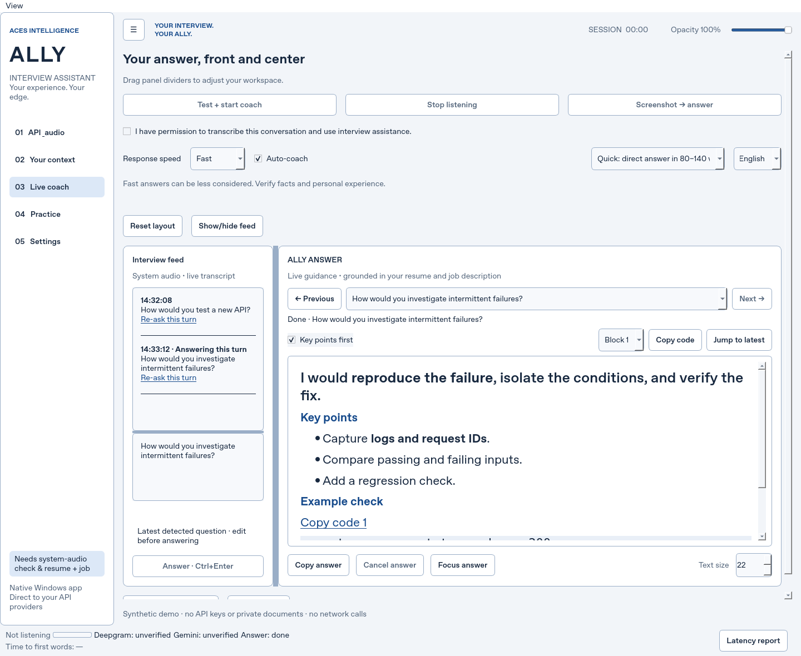

# ALLY 2.1 for Windows

A native desktop interview coach using your **Google Gemini** key for answer guidance and **Deepgram** key for live speech transcription. Bring your own resume and job description. The app streams suggestions, key talking points, and supporting resume evidence.

## Get started

1. Download **ALLY.exe** and double-click it on Windows 10/11 x64.
2. The first launch unpacks the bundled runtime into `%LOCALAPPDATA%\AcesIntelligence\ALLY`. Allow about a minute and approximately 400 MB of free disk space. Later launches reuse it.
3. No Python installation is required for ALLY.exe. The first launch uses Windows' built-in PowerShell `Expand-Archive`; it downloads nothing. Managed PCs must permit that command.
4. ALLY is unsigned. Windows may show an unknown-publisher prompt. Screen-share privacy and live APIs must be tested on your own Windows PC.
5. Under **API & audio**, paste a **Google AI Studio / Gemini Developer API** key. Click **Load available models**, select a Gemini text model (a Flash model is a good starting point for low latency), optionally use **Test Gemini (optional)**. Vertex AI credentials are not supported by this endpoint.
6. Paste your **Deepgram** key. Select the speech model, language, and the system output used by your meeting. ALLY captures system audio only. Microphone devices are never selected.
7. Under **Your context**, import a PDF, DOCX, TXT or Markdown resume and paste/import the job description. Review the extracted text. Scanned PDFs need OCR outside this app. Context fields have an 80,000-character limit each.
8. Open **Live coach**, confirm permission to transcribe/use assistance, then click **Test + start coach**. Play speech through your selected headphones/speakers during the four-second test. After one successful test, listening starts automatically. Use assistance in settings that allow it.

Only one successful transcription check is needed per app session for the current Deepgram settings and output device. Stop/start reuses the result. Once the live coach has started, subsequent starts and reconnections do not require another audio test. Temporary connection failures reconnect automatically; invalid credentials or settings need correction. Speech during an outage may be missed. The Google answer test is optional. Manual questions and screenshots work with Google credentials and context without a transcription test.

## New in 2.1

- Resizable panels, a collapsible sidebar, automatic stacked layout for narrow windows, and manual layout selection.
- Adjustable transcript/question divider, show/hide feed, reset layout, and saved window/layout preferences.
- Continuous transcription reconnects without repeating the initial audio check.

## Features introduced in 2.0

- A much larger answer canvas, 22 px text by default, adjustable from 16–32 px. **Focus answer** hides the transcript column.
- **Opacity** at the top right adjusts the entire window from 25–100%. Opacity and answer text size are saved with settings.
- **Screenshot → answer** briefly hides ALLY, captures the monitor containing the app, and sends the PNG to Google together with your resume/job context. Move ALLY to another monitor to capture that display. The image stays in memory and is not saved to disk. The click sends the whole visible monitor; close unrelated private content first. Protected windows may appear blank.
- **Response speed** defaults to Fast. It uses adaptive endpointing and wait times, interim speculation, pooled HTTPS, and a 40 ms display refresh. Detailed answers begin with the same direct opening and continue below it. The latency target is about one second; there is no guaranteed provider response time.
- Auto-coaching is on by default. The default answer style requests 80–140 words. Select Detailed for longer explanations.

## Interview workflow

- **System audio** captures the interviewer from your selected output device, including headphones. Set your meeting's speaker output to match. Close unrelated audio sources: all audio playing on that device is included. This mode does not capture your microphone unless your own voice is played back through the output.
- Final speech appears in the transcript. Edit the latest question as needed and click **Answer · Ctrl+Enter** or press **Ctrl+Enter** while this app has focus. **Ctrl+L** focuses the question field. Shortcuts are local to this app.
- Turn on **Auto-coach after a spoken turn** to generate automatically after a completed utterance and a short pause. Nearby completed chunks are joined. One answer slot is active at a time. Fast mode skips statements, small talk and unfinished clauses with a visible reason; use Ctrl+Enter to override. English question heuristics may miss questions in other languages. Balanced and Careful can respond to statements. Use manual mode when you need precise control.
- Choose a short answer, a detailed answer, talking points, or STAR guidance. Select English, Filipino, Taglish, or type another answer language. Spoken language is configured separately in the Deepgram settings. The speech model must support that language; the streaming test verifies compatibility.
- For follow-ups, Google receives the latest question, the last three transcript entries (up to 2,000 characters) in Fast mode, or up to 6,000 characters in other modes, your resume, and the job description. The prompt tells it to avoid inventing personal experience and to identify missing evidence. AI suggestions can still be wrong; check them before speaking. There is no guarantee of an accurate answer to every possible question.
- **Stop listening** closes the audio stream and network connection after collecting final transcript results. It does not cancel a Google answer already in progress; **Cancel answer** does that. Network calls have bounded timeouts, so cancellation can take until the next response chunk or timeout.
- **Export session notes** saves committed transcript text and completed answers to Markdown. Unsaved notes disappear when the app closes. **Save context profile** explicitly saves resume/job text to an unencrypted JSON file with no API keys; keep it private.

## Screen-sharing privacy

The **Exclude this app from supported screen captures** option is enabled by default. It calls the Windows `SetWindowDisplayAffinity(WDA_EXCLUDEFROMCAPTURE)` API on the main window and other Qt top-level windows, including app-created file dialogs. It verifies that Windows accepted the requested affinity and shows its status in settings. The option also applies again when the app's native window changes (for example when toggling always-on-top).

**This is best effort, not guaranteed invisibility.** Microsoft documents that affinity protects only a specific set of operating-system capture paths. Behavior varies by meeting app, capture mode, OS version, and graphics setup. Verify from a second participant/device or the actual shared view before relying on it. Share the meeting/presentation window rather than the entire desktop when possible. This app does not conceal processes, bypass proctoring, or prevent cameras/external capture from seeing your display.

## Keys, privacy, and cost

- Keys are masked and held in memory by default. Nothing is sent to an application backend: Google receives generation requests directly, and Deepgram receives audio directly over TLS. Proxy settings on your PC may affect networking.
- **Remember API keys** stores them in `%LOCALAPPDATA%\ALLY\settings.json`, encrypted with Windows DPAPI for your Windows user account. Unchecking this option removes saved encrypted keys immediately. Other settings are saved when you click Save or close the app. Context and transcripts are not stored in this settings file.
- DPAPI does not protect against another program running as your logged-in user. Do not share your API keys or add them to the source tree.
- No raw audio files, debug logs, analytics or crash uploads are written by the app. Transcripts and answers remain in memory unless exported. Provider-side retention, quotas, billing and data policies still apply.
- API tests are real, billable requests. Live transcription and every generated answer use your provider account. Automatic coaching can create more requests. Answer requests are not automatically retried. Live transcription automatically reconnects after temporary interruptions, which may create new billable streams.

## Build a standalone executable

**ALLY.exe is a self-contained Windows x64 launcher** carrying the Windows Python runtime and the application's dependencies. First launch extracts the bundle to your local application-data folder, then opens the native desktop app. It does not install a system-wide Python runtime. The bundled `source` folder contains the source code and third-party package metadata/license files remain with their packages.

For a conventional PyInstaller single-file build on your own Windows PC, install Python 3.12 x64, run Setup.cmd in the source folder, then Build-EXE.cmd. This produces `dist\ALLY.exe`. The included Windows workflow does the same. Neither build is code-signed.

To uninstall, close ALLY, delete ALLY.exe and `%LOCALAPPDATA%\AcesIntelligence\ALLY`. To remove saved settings/keys too, delete `%LOCALAPPDATA%\ALLY`. Context profiles and exported notes are stored wherever you chose to save them.

## Troubleshooting

| Symptom | What to check |
| --- | --- |
| Start listening is disabled | API keys, a selected Gemini model, system output, resume + job text within size limits, and the permission checkbox. The start button runs the single audio check if needed. |
| Speech test recognizes nothing | Play speech, not music or silence. Match the capture device to the meeting's output. Microphones are not captured. |
| Test fails after changing headphones | Refresh audio devices, select the new output, and retest. Bluetooth devices can switch audio profiles when a meeting starts; test with the meeting open. |
| HTTP 401 / 403 | Check the API key, service access, region, and billing. Google AI Studio keys and Vertex AI credentials are different. |
| HTTP 404 / model error | Reload the Google model list; verify Deepgram model/language support. Models can be retired. |
| HTTP 429 | Check account quota/rate limits and billing. Wait before retrying; use manual coaching to reduce requests. |
| Network / WebSocket error | Check firewall, VPN, proxy and TLS inspection. Allow HTTPS to `generativelanguage.googleapis.com` and WSS to `api.deepgram.com`. The live coach automatically reconnects after temporary disconnections. |
| Audio overflow | Close heavy applications if interruptions repeat. The coach reconnects after overflow; speech during interruptions may be lost. |
| The app appears in a screen share | Capture exclusion is not supported by that capture path. Verify the toggle/status and use window sharing or a separate device. |
| Scanned resume imports blank | Paste the resume text or apply OCR first. |
| Launch does nothing | Run Launch-Debug.cmd; check that Setup completed and Python 3.12 x64 is installed. |

## Developer verification

```
python -m pip install -r requirements-dev.txt
python -m pytest -q
```

Tests mock paid APIs and audio hardware and exercise request formatting, streaming parsing, model pagination, test invalidation, utterance assembly, audio lifecycle, window protection plumbing, context imports, and UI state. The UI was checked in a Linux offscreen Qt environment and the Windows launcher was cross-compiled and its PE structure/bundled contents checked. This environment cannot run Windows executables. Native launch, the Windows audio driver, capture behavior, DPAPI and paid-provider tests require verification on your Windows PC. No live provider success is claimed until you run the in-app tests.

## Provider and platform references

- Gemini model discovery: https://ai.google.dev/api/models
- Gemini generation and streaming: https://ai.google.dev/api/generate-content
- Deepgram streaming: https://developers.deepgram.com/reference/speech-to-text/listen-streaming
- Windows capture affinity: https://learn.microsoft.com/en-us/windows/win32/api/winuser/nf-winuser-setwindowdisplayaffinity
- Windows WASAPI audio library: https://github.com/s0d3s/PyAudioWPatch

Version 2.1.0. Source is included for review and modification. Dependencies retain their respective licenses.


## Response timing and local measurements

Instrumentation was added before changing the response policy. Each request attempt records monotonic timestamps for last detected speech, Deepgram `is_final` and `speech_final`, the auto-coach/manual trigger, request dispatch, first response **body byte**, first UI paint after streamed text insertion, and answer completion. Last speech is a local PCM energy proxy (50 ms capture chunks, threshold matching the meter); it is not ground-truth human speech-end detection. Background sound may delay speculation or make the timing estimate inaccurate. Deepgram timestamps record receipt, not provider processing time. Request dispatch is just before `Session.post`, not a packet capture. First paint is observed after a Qt viewport paint event, not verified monitor scan-out.

The status bar shows Time to first words for the current answer, median/p95 over the last 100 non-cancelled displayed attempts, and speculative cancellation count. The **Latency report** button displays/prints local JSON. `python main.py --latency-report` also prints it on exit (use Launch-Debug.cmd/a console to see stdout). No report is uploaded or automatically persisted; no prompts, transcripts or keys appear in it. Manual/screenshot latency starts at their trigger rather than a speech timestamp. Cancelled attempts retain their timestamps but are excluded from response-time aggregates.

| Response speed | Deepgram endpointing | Interim silence gate | Wait after clear question | Wait after unfinished clause |
| --- | ---: | ---: | ---: | ---: |
| Fast (default) | 250 ms | 280 ms | 0 ms | 650 ms |
| Balanced | 400 ms | 300 ms | 100 ms | 850 ms |
| Careful | 650 ms | Speculation disabled | 300 ms | 1,200 ms |

Interim silence is measured conservatively from the later of last energy detection and the last hypothesis update, checked every 40 ms. `UtteranceEnd` remains at Deepgram's supported 1,000 ms; shorter detection uses endpointing/local silence. Deepgram final chunks and interim text are assembled before speculation. Question marks/interrogative structures are required, with trailing conjunctions and greetings excluded. Final punctuation/case-only changes keep the existing stream; word similarity below 92%, two or more appended words, negation changes or number changes replace it. Resumed speech cancels an unconfirmed draft. Early text is labelled as a draft until confirmed, and only one confirmed answer is added to history. False starts can still produce an early draft; Fast can be less considered.

Cancellation immediately invalidates the request epoch, clears its pending display/history, signals the stream, asynchronously closes an attached HTTP response, and releases the UI slot. A stale worker cannot overwrite or release a newer request. If cancellation occurs before HTTP headers arrive, the old network operation can remain pending until headers/timeout; its output is discarded. A replacement may overlap that **already-cancelled** transport/server request. Client cancellation cannot guarantee that the provider stops billing. The report exposes scheduled/sent attempts and cancelled speculative attempts (including cancellation before dispatch); it is a cost-impact indicator, not a provider invoice. Live answer failures use the bounded automatic fallback policy below when enabled. With fallback disabled, a failed answer is not automatically retried. Replacing a changed transcript is a new billable attempt, not a retry of a failed answer.

One shared `requests.Session` pools HTTPS connections with retries disabled. An unauthenticated root GET, with no key/context and no generation, warms DNS/TCP/TLS when coaching begins and after 45 seconds idle; it consumes/closes the response for connection reuse. Failure does not block coaching. The static resume/job reference prefix is built once per session (rebuilt if edited), follows the fixed system instructions, and precedes changing question/history/style. This makes implicit provider cache reuse possible, not guaranteed. Quick style uses a 2,048-token ceiling for zero-thinking Gemini 2.5 Flash variants and 8,192 for other models to leave room for thinking; other styles use 4,096 / 16,384 respectively. These are ceilings, not requested prose lengths; Quick still asks for concise answers. Higher ceilings can allow more billable output if a model ignores the style instruction. Flash-Lite is the initial default; model discovery prefers an available stable Flash-Lite. You can override it. Gemini 2.5 Flash uses zero thinking, Gemini 3.x Flash/Pro low thinking. Capability/availability still depends on your key.

### Reproducible mocked experiment

Run `python -m tools.latency_benchmark` (no network, keys, audio or GUI). Full traces/assumptions: [LATENCY_BENCHMARK.json](LATENCY_BENCHMARK.json). The experiment exercises the actual question gate, Gemini SSE parser and latency recorder with a fake clock, mocked response chunks and a modeled 40 ms UI repaint. It models 20 complete questions, an interim arriving 80 ms after speech, final receipt at 500 ms, cold connection overhead 180 ms before versus a prewarmed connection after, first-byte delay 300–680 ms, and 80 ms to the first text SSE event. The previous trigger is final + 450 ms; the optimized trigger is interim + 280 ms. This is an explicit deterministic simulation, not an empirical network benchmark. No latency improvement from provider caching or smaller prompts is assumed.

| Mocked pipeline (20 turns) | Median time to first words | p95 (nearest rank) |
| --- | ---: | ---: |
| Previous final + fixed wait + cold connection | 1,740 ms | 1,910 ms |
| Fast interim + adaptive wait + warm connection | 970 ms | 1,140 ms |

These results support the one-second target under those assumptions; they do not prove one-second live performance. Real Windows tests must measure system-audio buffering, speech-end/noise detection, Deepgram interim/final arrival, network/TLS reuse, Gemini first-byte/token latency, actual viewport paint and cancellation/billing behavior with your keys. Compare matched questions/modes, include correction/cancellation counts, and export the local report. Hardware/device, provider load, resume size, throttling and UI visibility can materially change median/p95. No live Windows/provider measurements were performed here.

## Practice mode

Open **Practice** next to **Live coach** after importing your resume/job description and entering your Google key. Choose **Behavioral**, **Technical** or **Mixed**, an Introductory/Intermediate/Advanced difficulty, and **3–15 questions**. ALLY shows one generated question at a time. Type an answer, or click **Find microphones**, select an input and **Record answer** with your Deepgram key. Stop recording, review/edit the transcript, then submit. Recording is opt-in and capped at two minutes. Live coach remains system-audio-only; stop it before starting Practice.

Each answer receives a **1–5 score**, **two strengths**, **two improvements**, and a stronger sample answer. Sample sentences cite exact resume quotes; ungrounded sentences are flagged **Confirm with your own example** and listed as missing facts. Absent evidence quotes, malformed JSON and invalid/incomplete scores or feedback are rejected. An exact quote is a grounding check, not proof of every inference: review AI coaching against your resume. The final summary shows your average, averages by question type and the weakest type(s), including ties.

**Read question aloud** uses the installed Windows SAPI voice via built-in Windows PowerShell. No extra dependencies or cloud speech service are added. If unavailable/blocked, read the question text instead. **Stop voice** interrupts playback; recording is disabled during playback. Spoken questions have a 30-second limit.

**Cancel session** stops requests, recording and speech and discards late results. Gemini calls have 5-second connect / 15-second read timeouts plus a 45-second overall UI/worker deadline. No automatic retries are made for questions, scoring or microphone streams. After errors/timeouts the draft answer is retained; another manual submission is another billable request. Server billing can continue after client cancellation.

Practice reads API keys currently in memory; it adds no separate key store or disk copies. Existing opt-in DPAPI **Remember API keys** remains controlled under **API & audio**. Practice context snapshots, answers, feedback and scores stay in memory; starting another session replaces them. No audio/session files or telemetry are written. Tests mock Gemini/Deepgram and cover JSON parsing, evidence checks, session state, microphone isolation, cancellation/timeouts and the full typed-session/summary UI flow. Windows drivers and installed SAPI playback still require real-device verification.

## UI and reading controls

Answers now render Markdown as they stream (headings, bold text, lists and monospaced fenced code). Each code block has a **Copy code** link; the toolbar also provides a block selector and **Copy code** button. Code is never executed. **Key points first** enlarges the existing opening and moves an existing Key points section ahead of details; it does not ask Gemini for extra content or change the prompt. Native Qt Markdown parsing is used, with raw HTML and resource loading disabled.

**Previous / Next** and the answer list keep the reading history for this app run. A new request updates a separate history entry and leaves the answer you are reading in place; **Jump to latest** selects the newest entry. Scrolling upward pauses streaming auto-scroll; Jump to latest resumes it. Cancelled speculative text is discarded, and cancelled entries are labelled. History is kept in memory and is not silently added to settings or to the prompt. Existing note export continues to export confirmed answers.

The transcript groups final segments into timestamped visual turns, dims interim text, and marks the turn associated with the selected answer. **Re-ask this turn** uses the existing manual answer path (and makes a billable request when ready). The multi-line question field remains editable; its badge identifies a detected question or a draft being edited. As before, incoming speech does not overwrite a focused, nonempty draft.

The single bottom status strip shows listening, audio level, Deepgram/Gemini state, answer state and latency. “Ready” means a successful test/request, not a background connectivity guarantee. Errors appear in a non-blocking banner with **Fix →** opening the relevant Settings section. Destructive clear/close confirmations remain dialogs.

Use **View → Auto layout / Side by side / Stacked / Focus**, **Compact mode**, or **Mini bar**. Mini bar contains the latest answer and listening state; **Full window ↗** restores the normal workspace. The searchable **Settings** page groups API & audio, Your context, Coaching, Appearance and Privacy; API/context sections link to their full editors. Appearance offers **Light, Dark, High contrast, Follow Windows**, a font picker, 16–32 px answer text and 25–100% opacity. Preferences are saved by Save settings or on close. All colors and document styles live in `compass/themes.py` and are applied through QSS/palette. Qt native color/contrast preferences are followed; reduced motion and High contrast disable the subtle 100 ms sidebar transition. Resize updates are coalesced, and always-on-top restores geometry, state, opacity and capture affinity.

No dependencies were added and no audio, transcription, speculative-generation policy or prompt code changed. Existing local Ctrl+Enter / Ctrl+L shortcuts remain. Qt 6 uses logical pixels and SVG/native assets; the launcher explicitly preserves fractional DPI scaling.

### Screenshots (synthetic demo data)

Generate these without keys or network calls with `python -m tools.render_ui` (`QT_SCALE_FACTOR=1.25`, `1.5` or `2` can also be used for offscreen previews). They are illustrations, not proof of native Windows display behavior.

| Dark | Light |
| --- | --- |
|  |  |

[High contrast](docs/screenshots/high-contrast.png) · [Searchable settings](docs/screenshots/settings.png) · [Mini bar](docs/screenshots/mini-bar.png)

Still check on a real Windows display: 125/150/200% text and icon scaling; moving between monitors with different DPI; Windows light/dark and accessibility-contrast changes (including custom contrast colors); reduced-motion preferences; scrollbar/trackpad behavior; Mini bar placement/restoration and always-on-top without flicker; capture exclusion in actual meeting capture modes after each window transition. Offscreen tests verify themes/palette, presets and persistence, answer navigation, code copying, scroll pause/resume, transcript grouping and banners, but cannot validate physical monitor output or capture-tool behavior.

## Overlay and Compact bar

Select **View → Standard / Overlay / Compact bar**. Standard keeps the existing sidebar, splitters and layouts; the older Mini bar remains available. Overlay is a separate frameless dark shell with a 54 px toolbar, 46 px listening panel and answer panel, separated by 10 px gaps. It defaults to 900 px wide, clamped to the available screen. Its four accent presets and remappable shortcuts are under **Settings → Appearance**. Inter/JetBrains Mono are used if installed, otherwise Segoe UI/Consolas; fonts are not downloaded. Theme colors live in `themes.py`.

The toolbar reuses Start/Stop system audio, the existing model selector, Answer, Screenshot, and Cancel. **Chat** opens an inline follow-up field: Enter uses the same manual question/context path. **Hint only** selects existing Talking points, and **Explain out loud** selects existing Detailed guidance (it does not synthesize speech). More provides Standard, Overlay, Cancel, Export notes and Settings. Capture consent and required setup still apply; open Standard to configure them. The five-bar meter uses the actual capture-level value. The timer records session time, not a separate recording file.

Answers mirror the shared in-memory history; new answers do not replace the entry being read. Previous/Next or **Alt+Left/Right** navigate. **Jump to latest** selects the newest entry and resumes auto-scroll after upward scrolling pauses it. Display headings, inline code chips, fenced blocks (including unfinished fences), language labels, code copying and lightweight syntax coloring are presentation only: prompts, audio and provider logic are unchanged. Clear asks for confirmation before clearing unsaved view content; clearing the actively generated answer invokes the existing Cancel action. Transcript Clear clears the visual feed, while session notes and provider context remain available. Export notes before clearing if needed.

Default app-local shortcuts: Ctrl+Enter Answer, Ctrl+L question editor, Ctrl+Shift+S Screenshot, Ctrl+Shift+C Chat, Alt+Left/Right history, Ctrl+Backspace Clear answer, Ctrl+Shift+Backspace Clear transcript. Appearance supports remapping (conflicting assignments are rejected). Hints appear in tooltips and, at wide widths, on buttons. The Move handle supports dragging and arrow-key nudging; toolbar background also drags. Use edges, corners, the grip or Resize. Geometry is remembered separately per shell; opacity and optional always-on-top are shared. Capture exclusion is reapplied after native window changes and shell switches.

Compact bar is 56 logical pixels when idle/listening; it grows while showing streaming answers at 17 px, with Cancel, Expand and a blinking accent caret. Text status, accessible names, keyboard focus rings and polite state announcements supplement color; tokens are not individually announced. Overlay intentionally stays dark even when Standard uses another theme. Minimum control targets are 28 px. Screen-edge geometry restoration is clamped to the current display.

Offscreen tests cover shell switching/persistence, incomplete fences, history, scroll pause/resume, compact state transitions, shortcut remapping and capture-affinity calls. Still verify on Windows: DPI 125/150/200%, multi-monitor placement and different scaling factors, frameless native move/resize and always-on-top, screen-reader announcements/focus, high-contrast usability of the intentionally dark Overlay, and actual screen-share exclusion after every shell/window-state transition.


Output-limit handling: Quick mode no longer uses a 512-token ceiling. A cutoff triggers bounded recovery when automatic fallback is enabled. If recovery is disabled, cutoffs retain partial text with one explicit incomplete-answer notice; a thinking-only cutoff is an error. Update the executable to receive these changes; a source update does not modify an already downloaded EXE.


## Automatic answer fallback

**Settings → Coaching → Automatically recover failed answers** is on by default and saved locally. It applies to Live coach, manual answers, Chat and Screenshot answers. Practice generation/scoring and the optional Google connection test remain single-request. The selected answer mode is a preference: a complete useful response is accepted even without the requested headings, STAR structure or code. Truthfulness rules and the requested language still apply.

The selected model is attempted first. On a timeout, connection/stream error, unavailable model, invalid generation settings, model-access HTTP 403, HTTP 429/5xx, empty response or output limit, ALLY tries up to two other stable text Flash models with a direct 80–140 word answer and optional formatting. Recovery removes optional thinking parameters that may be unsupported and reserves at least 8,192 output tokens as headroom; this is a ceiling, not a requested answer length. It prefers newer Flash-Lite models, then Flash. **Load available models** supplies the account-specific catalog for this app session; if absent, it is fetched once after the first failure. If catalog discovery fails, the bounded backup list is `gemini-3.5-flash-lite`, then `gemini-3.8-flash`. Catalog visibility does not guarantee generation quota/access. A single-model catalog gets one simpler-format attempt with that same model instead. A model is otherwise attempted only once, and the user's selected default is not changed. No other provider or additional key is used.

Generation has at most **3 sequential attempts**, a **45-second scheduling deadline** including catalog lookup, and a **15-second watchdog per attempt** (up to 4-second connect / 8-second read timeouts, shortened near the deadline). The watchdog closes an attached response; DNS/connection operations before headers can take until the network timeout. Recovery has no unbounded retries or transport retries. **Cancel answer** immediately releases the UI slot, closes the current response when attached, discards late output and prevents further fallback dispatches. HTTP 401, explicit invalid/expired key or disabled billing/service errors, and provider safety blocks stop with an actionable error instead of trying other models. Other HTTP 403 errors can be model-specific, so they allow the bounded model fallback; account-wide restrictions can still prevent every attempt. Local validation errors do not send another request.

The status strip shows the attempt number, actual model, selected/simple format and result. A replacement streams into the **same history entry**, replacing the old draft when its first text arrives. If every attempt fails, the longest partial draft is retained and explicitly marked **Incomplete**; if none produced text, an error directs you to connection/model/quota settings. Fallback can therefore differ from the requested style. It never supplies an invented offline personal answer, and it cannot guarantee service during a total outage, exhausted account quota or invalid key.

Each additional generation can be billable, including failed/cancelled attempts. **Latency report** includes total dispatched generation attempts, `fallback_attempts_sent` and per-attempt model/outcome/reason/timestamps, alongside speculative cancellation counts. Reports contain no keys, prompts or answers and stay local. This readout is a cost indicator, not a provider invoice. First-words latency includes an early partial draft if it was shown before recovery; per-attempt first-byte/completion timestamps expose recovery delays.

Mocked API and offscreen Qt tests cover format tolerance, model ordering/discovery, server/network/empty/truncated responses, sequential replacement without duplicate history, bounded exhaustion, partial retention, cancellation before/during/between attempts, deadline/watchdog handling, credential/block stops, saved preference and request accounting. No paid requests are made in tests. Before an interview on Windows, install the newly built EXE, load available models and run an answer test with your actual key; check audio, your imported context and quota. A successful test does not guarantee the next network request will succeed.
